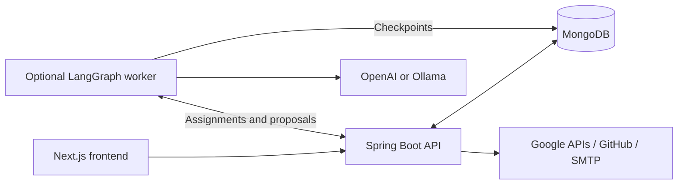

# HiCaptain

An open-source project workspace for human teams and AI assistants. Organize projects, tasks, people, meetings, files, and GitHub activity with organization-scoped access and human review of AI proposals.

**Website:** [hicaptain.dev](https://hicaptain.dev) · **Backend:** [blueprint-dev.onrender.com](https://blueprint-dev.onrender.com) · **License:** [MIT](LICENSE)

The website is the planned production frontend. The backend URL is the existing Render service supplied by the maintainer; its deployed revision may differ from this branch. Merging updates that service only when Render is configured to deploy the target branch.

## Features

- **Organizations and people:** Create a workspace as its Admin, invite teammates by email, join multiple organizations, and hold multiple roles. New accounts get an editable generated display name. Existing accounts can be added directly; new teammates register through an expiring invitation link.
- **Project planning:** Set a team, description, start date, and tentative end date. New projects default to today and 30 days later. Manage tasks through Kanban with priorities, deadlines, and developer assignments. Admins manage organization roles; assigned project managers manage permitted developer access.
- **Google Workspace:** View Calendar events, create meetings with Meet links, select a personal My Drive folder for project files, and refresh folder sharing. Copy tasks to your own Google Tasks list. This does not require a Workspace shared drive; task copying is not bidirectional synchronization.
- **GitHub:** Connect your own account, link repositories to a project, and view development activity from project details. Optional signed webhooks persist supported repository events.
- **AI teammates:** Configure OpenAI or Ollama planners/researchers with your own keys or hardware. Assign work from a project or Kanban task, refine proposals, and approve tasks and shared decisions. Runs check current access, retain bounded project context, and record token usage and estimated costs. [Worker setup and limits](agent-worker/README.md).
- **Account and communication:** Edit your profile, change your password, sign out from the profile menu, and use project feedback and in-app notifications.

AI teammates do not execute code or browse the web. Analytics, invoicing, and payments are not part of the current product.

## Stack and layout

| Directory | Implementation |
| --- | --- |
| [`frontend/`](frontend/) | Next.js 16, React 19, TypeScript, CSS Modules/Tailwind, Lucide icons |
| [`backend/`](backend/) | Java 17, Spring Boot 3.5, Spring Security/JWT, MongoDB, SMTP and integration clients |
| [`agent-worker/`](agent-worker/) | Optional Python 3.12/LangGraph worker with MongoDB checkpoints; OpenAI or Ollama |
| [`.github/workflows/checks.yml`](.github/workflows/checks.yml) | Frontend, backend, worker tests and dependency checks; no automatic deployment job |



## Local development

Requirements: **Node.js 22**, **Java 17 JDK**, and **MongoDB**. Python 3.12 is needed only for AI execution. External integrations are optional until used.

### Backend

```bash
cp backend/.env.example backend/.env
cd backend
bash ./mvnw spring-boot:run
```

Before starting, set `MONGODB_URI`, `MONGODB_DATABASE`, and `JWT_SECRET` in `backend/.env`. Use a reachable MongoDB instance and an application user with access to that database. A local URI is `mongodb://localhost:27017/hicaptain`.

Generate a base64-encoded 32-byte secret with either command:

```bash
openssl rand -base64 32
```

```powershell
python -c "import base64, secrets; print(base64.b64encode(secrets.token_bytes(32)).decode())"
```

Generate separate values for JWT signing and the Google/provider encryption keys. Keep existing encryption keys unchanged when upgrading a database with connected accounts. Rotating the JWT secret signs out existing sessions. Never commit real `.env` files.

On Windows, set `JAVA_HOME` to the JDK directory **without** `\bin`, add `%JAVA_HOME%\bin` to `PATH`, and run `./mvnw.cmd spring-boot:run` from `backend`.

### Frontend

```bash
cd frontend
cp .env.example .env.local
npm ci
npm run dev
```

Open `http://localhost:3000`. The local template uses `NEXT_PUBLIC_API_URL=http://localhost:8080`. Create an organization, then invite teammates from the team page. SMTP must be configured before invitations can be delivered.

## Deploy the backend to the existing Render service

Production API origin: **`https://blueprint-dev.onrender.com`**.

1. In the existing Render web service, confirm the connected repository is this repository and the deployment branch is the branch you intend to merge into, normally `main`. Enable automatic deployment if you want merges to deploy automatically.
2. Use **Docker** with **Root Directory `backend`**, **Dockerfile Path `./Dockerfile`**, and the backend directory as the Docker build context. The Dockerfile builds the Java application and runs it as a non-root user; no separate build/start command is needed for this setup.
3. In **Environment**, add the values from [`backend/.env.render.example`](backend/.env.render.example). Replace every `REPLACE_*` value. Use **`SPRING_PROFILES_ACTIVE=prod`**, not `demo` or `docker` for this setup. Render supplies `PORT`; the application reads it automatically. Remove any old `SERVER_PORT` variable because Spring treats it as an explicit port override.
4. Point `MONGODB_URI` at a reachable MongoDB service, such as Atlas, and set the actual `MONGODB_DATABASE`. Use an application database user and allow the Render service's outbound addresses in your database network rules. The hostname `mongodb` from local Compose does not resolve on this standalone Render service.
   Remove stale callback overrides (`GITHUB_OAUTH_REDIRECT_URI`, `GOOGLE_LOGIN_REDIRECT_URI`, `GOOGLE_OAUTH_REDIRECT_URI`) unless they match the production URLs below. If the service already has `SPRING_DATA_MONGODB_URI` or `SPRING_DATA_MONGODB_DATABASE`, update them too or remove them in favor of the template variables; Spring gives these direct property overrides priority.
5. Set **Health Check Path `/`**. After merging, deploy the new commit if automatic deployments are disabled. Confirm the deploy log reports the intended commit and a successful Spring startup.
6. Open the API root. It should return JSON containing `"status":"running"`. This checks the API process; test registration, invitations and configured integrations separately.

Core values for this deployment:

```dotenv
SPRING_PROFILES_ACTIVE=prod
MONGODB_URI=REPLACE_WITH_YOUR_MONGODB_CONNECTION_STRING
MONGODB_DATABASE=hicaptain
JWT_SECRET=REPLACE_WITH_BASE64_32_BYTE_SIGNING_KEY
BACKEND_URL=https://blueprint-dev.onrender.com
FRONTEND_URL=https://hicaptain.dev
CORS_ALLOWED_ORIGINS=https://hicaptain.dev,https://www.hicaptain.dev
```

The complete Render template includes stable encryption keys, OAuth, SMTP, and optional worker settings. OAuth credentials are optional for email/password sign-in. SMTP is required for invitations. Provider keys for AI inference are entered by an organization admin in Settings; they are not frontend environment variables.

The `prod` profile enables forwarded HTTPS headers and reduces application/security logging to INFO. Normal startup preserves data. Demo seeding requires the explicit `demo` profile and a disposable database ending in `_demo`.

## Deploy the frontend

On Vercel, or your existing Next.js host:

- Set the project root to **`frontend`**, use Node.js 22, install with `npm ci`, and build with `npm run build`.
- Set this **frontend** environment variable for the production deployment:

  ```dotenv
  NEXT_PUBLIC_API_URL=https://blueprint-dev.onrender.com
  ```

- Add `hicaptain.dev` as the custom domain and configure its DNS using the values supplied by your host. If using `www`, add that domain too and redirect it to the canonical domain.
- Redeploy after changing `NEXT_PUBLIC_API_URL`: Next.js includes this value at build time. Never put JWT secrets, OAuth client secrets, database passwords, or model keys in `NEXT_PUBLIC_*` variables.

If using a preview or temporary frontend URL, add its **exact origin** to `CORS_ALLOWED_ORIGINS`. Set `FRONTEND_URL` to the intended canonical frontend so invitation and OAuth-return links go to the right site. Origins have no path or trailing slash. Credentialed requests do not support a wildcard allowlist.

## OAuth and invitation email setup

### Production callback URLs

Register these exact values with the providers:

| Provider / purpose | Authorized callback |
| --- | --- |
| GitHub sign-in and repository connection | `https://blueprint-dev.onrender.com/api/auth/github/callback` |
| Google sign-in | `https://blueprint-dev.onrender.com/auth/oauth/google/callback` |
| Google Workspace connection | `https://blueprint-dev.onrender.com/api/google-calendar/auth/callback` |

For local development, replace the Render origin with `http://localhost:8080`. Local Compose exposes the API on `http://localhost:8081`; its registered callbacks must use that port instead. Callback scheme, host, port, path and trailing slash must match exactly.

### GitHub

Create **one GitHub OAuth App** under Settings → Developer settings → OAuth Apps. Use `https://hicaptain.dev` as the homepage and the GitHub callback above. Set `GITHUB_OAUTH_CLIENT_ID` and `GITHUB_OAUTH_CLIENT_SECRET` on the backend. Sign-in requests identity scopes; connecting repository access requests the configured repository/webhook scopes. No deployment-wide GitHub personal access token is required.

Optional webhooks require `GITHUB_WEBHOOK_SECRET` of at least 32 random characters. Register the HTTPS callback `https://blueprint-dev.onrender.com/api/github/webhook` with that same secret. Generate a secret with `openssl rand -hex 32`. The receiver verifies HMAC signatures and deduplicates supported events.

### Google

Create an OAuth client of type **Web application** in Google Cloud Console / Google Auth Platform. Add **both** Google callback URLs above to Authorized redirect URIs. Use `https://hicaptain.dev` as the frontend origin where the client configuration requests a JavaScript origin. Set `GOOGLE_CLIENT_ID` and `GOOGLE_CLIENT_SECRET` on the backend, enable Calendar/Drive/Tasks APIs, and configure the consent screen. Add your test accounts while the app is in testing; broader use may require Google's publishing/verification process.

Google sign-in requests identity only. **Connect Google Workspace** separately asks for Calendar, Drive and Tasks together. Preserve `GOOGLE_TOKEN_ENCRYPTION_KEY` for existing connections. A Google `redirect_uri_mismatch` means the authorization request's exact `redirect_uri` is missing from that same OAuth client's registered redirects.

OAuth connection flows use a browser-binding cookie. Some browsers block cross-site cookies between `hicaptain.dev` and `onrender.com`. For reliable operation with those browsers, add **`api.hicaptain.dev`** as a custom domain on Render, then change `BACKEND_URL`, `NEXT_PUBLIC_API_URL`, and registered callback URLs to that origin and redeploy both services. Keep `FRONTEND_URL=https://hicaptain.dev` and the frontend CORS allowlist unchanged. Do this only once the API domain and TLS are configured.

### SMTP

Set `SMTP_HOST`, `SMTP_PORT`, `SMTP_USERNAME`, `SMTP_PASSWORD`, and `SMTP_FROM` using your provider's actual values. The template uses authenticated STARTTLS on port 587; confirm your Render plan and SMTP provider permit that connection. `SMTP_FROM` must be an allowed/verified sender. Invitations contain links based on `FRONTEND_URL` and fail visibly if delivery fails.

## Optional AI worker and self-hosting

Deploy the Python worker separately to execute AI assignments. Set the same random `AGENT_WORKER_SECRET` in the backend and worker, point `HICAPTAIN_API_URL` at the backend, and connect the worker to the same MongoDB database for checkpoints. Without a worker, queued assignments will not execute. See [agent-worker/README.md](agent-worker/README.md) for setup, permissions, model support and usage accounting.

A cloud worker cannot reach Ollama running on your personal computer through `localhost`. Use a deliberately reachable Ollama origin allowed by `AGENT_OLLAMA_ALLOWED_ORIGINS`, or use OpenAI with your own key.

For local/container hosting, configure `backend/.env` and run from `backend`:

```bash
docker compose up --build -d
# Include the optional worker:
docker compose --profile agents up --build -d
```

Compose includes the backend, private MongoDB and optional worker; run/deploy the frontend separately. Supply the required MongoDB root and application passwords. Existing volumes need the [application-user migration](backend/docker/README.md); do not delete production volumes to apply it. Keep existing encryption keys stable. Rotate any previously exposed Google client secret using the [rotation guide](docs/audits/credential-rotation.md).

## Verification

[GitHub Actions](.github/workflows/checks.yml) runs these checks on pushes and pull requests:

```bash
# frontend/
npm run lint
npm run typecheck
npm test
npm run build
npm audit

# backend/ — use an isolated test MongoDB, never production
bash ./mvnw test
python docker/test-compose.py

# agent-worker/ — after installing requirements.lock
python -m unittest -v
```


Released under the [MIT license](LICENSE). See the [backend guide](backend/README.md) and [agent guide](agent-worker/README.md) for implementation details.
